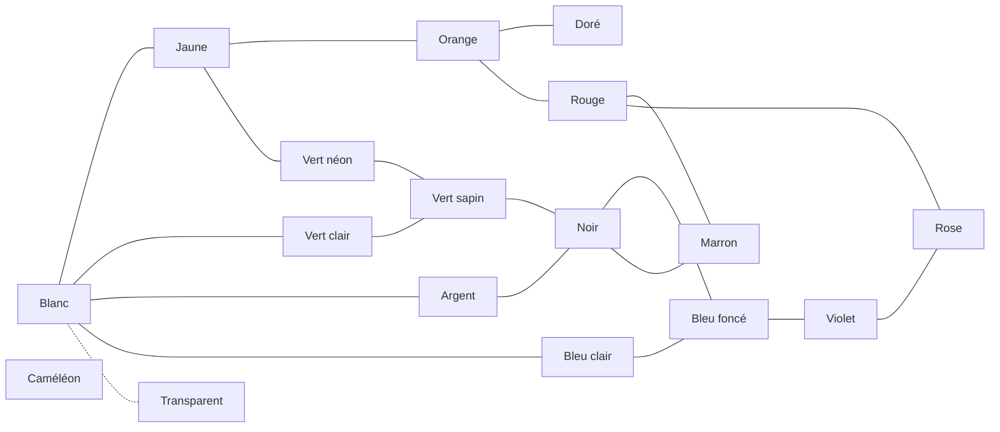

# Salamandres — Game Design Document

Version du 29/10/2026 · Guillaume Martigny

## Vision

Un jeu de collection où l'on élève de petites salamandres virtuelles et où l'on les croise pour faire apparaître des mutations rares. Le cœur du plaisir est l'aléatoire des mutations : chaque éclosion peut réserver une surprise.

- **Plateforme** : interface web responsive, jouable sur mobile en mode portrait.
- **Genre** : idle game léger. La progression continue sans le joueur, sans friction artificielle et sans monnaie premium.
- **Mode** : solo dans un premier temps.
- **Visuels** : salamandres générées à partir de leurs gènes, même avec un rendu simple. Pencil.js est envisagé, sans être obligatoire.

## Génétique

Chaque salamandre porte quatre gènes, chacun avec son propre mécanisme d'évolution. Chaque valeur a un nom latin, ce qui donne à chaque individu un nom d'espèce.

| Gène | Valeurs | Rôle visuel | Mécanisme |
| --- | --- | --- | --- |
| Couleur principale | 17 | Couleur de fond | Mutation dans le graphe des couleurs |
| Couleur secondaire | 17 | Couleur du pattern | Mutation dans le graphe des couleurs |
| Pattern | 14 + sans pattern (*iustus*) | Motif sur le corps | Fusion de patterns entre parents |
| Détail | 7 (dont aucun) | Trait physique | Influencé par les décorations du terrarium |

### Hérédité des couleurs

1. La couleur principale est tirée en premier : héritée d'un des parents, puis mutation éventuelle.
2. La couleur secondaire est tirée parmi les couleurs des parents, en retirant du pool la couleur principale obtenue.
3. Si le pool est vide, la secondaire mute de force vers une voisine dans le graphe.

- Principale et secondaire doivent être différentes, y compris pour un individu *iustus* dont la secondaire est cachée.
- Seule exception : caméléon / caméléon est autorisé.
- Un individu *iustus* transmet quand même sa couleur secondaire cachée. Elle peut réapparaître chez ses petits.

Avec deux couleurs distinctes, on obtient environ 26 900 combinaisons visibles (17 × 16 × 14 × 7, plus les cas sans pattern).

## Couleurs et mutations

À la naissance, chaque couleur héritée peut muter vers une couleur voisine dans le graphe. Les liens fonctionnent dans les deux sens.

Trait plein : mutation possible dans les deux sens. Pointillés : transition très rare. Le caméléon est relié à toutes les couleurs (non dessiné), avec une transition très rare.

Le blanc est la couleur de départ. Le noir sert de carrefour entre les verts, les bleus et le marron.

- **Rareté** : chaque couleur a sa propre rareté, indépendante de sa distance au blanc. La chance de mutation vers une couleur dépend de la rareté de cette couleur cible.
- **Argent et doré** : couleurs rares.
- **Transparent** : accessible uniquement depuis le blanc, avec une probabilité très faible.
- **Caméléon** : relié à toutes les couleurs, avec une probabilité très faible. Sa couleur change en permanence.

À trancher : la valeur de rareté de chaque couleur.

## Patterns et détails

Pour éviter de répéter la mécanique des couleurs, patterns et détails évoluent chacun d'une façon différente.

### Patterns : fusion

- Croiser deux parents aux patterns précis peut donner un nouveau pattern (exemple : points + anneaux → étoile).
- Le joueur découvre ces « recettes » par l'expérimentation, ce qui complète l'aléatoire des couleurs.
- Patterns : lignes verticales (*recta*), zébré (*riga*), feuille (*folia*), nuages (*nuba*), splash (*macula*), points (*puncta*), anneaux (*annula*), dégradé (*progressa*), pattes seules (*gamba*), tête seule (*capita*), volutes (*voluta*), flèches (*sagitta*), étoile (*stella*), crâne (*crania*).
- Sans pattern (*iustus*) : seule la couleur principale est visible.

### Détails : environnement

- Les décorations du terrarium augmentent la chance d'apparition de certains détails (exemples : bassin → palmé, zone sombre → luminescent, plantes → feuillu).
- Détails : aucun, corné (*cornum*), palmé (*palmatum*), luminescent (*lucidum*), gros yeux (*oculum*), nain (*pumilum*), feuillu (*frondosum*).

À trancher : la table des recettes de fusion et la table décoration → détail.

## Cycle de vie et reproduction

Le terrarium sert d'enclos de reproduction : le joueur choisit ses croisements en répartissant mâles et femelles entre ses terrariums.

1. **Ponte** : les adultes d'un même terrarium ont une chance de se reproduire, tant qu'il reste de la place. Le délai entre deux pontes est aléatoire dans une plage (exemple : 1 à 5 minutes). La qualité des décorations augmente cette chance.
2. **Œuf** : il incube directement dans le terrarium et occupe une place.
3. **Pupe** : stade intermédiaire avant l'âge adulte.
4. **Adulte** : stade définitif, la salamandre ne meurt pas.

- Les salamandres sont sexuées. S'il y a plusieurs couples possibles dans un terrarium, la paire mâle/femelle est tirée au hasard. Isoler un couple seul permet de forcer un croisement.
- Un terrarium plein ne produit plus d'œufs. Pour continuer, le joueur vend des salamandres ou achète un terrarium.
- Hors ligne, la ponte continue jusqu'à ce que les terrariums soient pleins : c'est une limite naturelle, sans friction artificielle.

À trancher : les durées d'incubation et de pupe. Contrainte : la première éclosion doit arriver très vite (piste : première ponte en moins d'une minute, œuf 1 à 2 minutes, pupe environ 5 minutes).

## Économie

Une monnaie unique, les **pièces** (nom provisoire), sert à tous les achats et toutes les ventes.

- **Départ** : le joueur commence avec de quoi acheter un petit terrarium et un couple de salamandres communes.
- **Prix d'un spécimen** : calculé à partir de sa rareté. La rareté découle de la probabilité des mutations qui ont produit ses traits, combinée à la rareté de son détail.
- **Terrariums** : le joueur peut en acheter autant qu'il veut. Leur taille fixe le nombre d'individus.
- **Décorations** : elles augmentent la chance de reproduction, influencent les détails et personnalisent le terrarium.
- **Marché** : il propose des salamandres aléatoires, livrées après un court délai. L'offre se renouvelle à intervalle régulier (exemple : toutes les 10 minutes) et permet de diversifier les gènes.
- **Commandes spéciales** : une ou plusieurs salamandres aux traits précis à livrer dans un délai imparti, contre une récompense en pièces intéressante.

À trancher : la rareté chiffrée de chaque couleur, pattern et détail, et les prix des terrariums et décorations.

## Objectifs et encyclopédie

Le joueur a toujours un objectif à chacun de trois horizons, et l'encyclopédie porte la sensation de complétion.

| Horizon | Objectif | Récompense |
| --- | --- | --- |
| Court terme | Commandes spéciales | Pièces |
| Moyen terme | Compléter une collection thématique | Récompense dédiée |
| Long terme | Compléter l'encyclopédie, avec un taux global en % | Prestige |

### Encyclopédie

- Chaque combinaison découverte est enregistrée.
- Des pages par couleur, par pattern et par détail rendent la progression lisible malgré les ~26 900 combinaisons.

### Collections thématiques

Chaque collection regroupe 5 à 10 salamandres précises, avec des références amusantes. Pistes :

- **Fêtes** : Halloween (*crania* orange sur noir), Saint-Patrick (*folia* vert sur vert clair), Noël…
- **Drapeaux** : France, Italie, Jamaïque…
- **Pop culture** : rasta (*nuba* rouge, vert, jaune), les plombiers (*gamba* rouge et *gamba* verte)…
- **Nature** : zèbre (*riga* noir sur blanc), coccinelle, abeille…
- **Feux et couleurs** : feu tricolore, arc-en-ciel…

Si le jeu devient public, éviter les noms de marques déposées (« les plombiers » plutôt que les noms des personnages).

## Technique et points ouverts

- **Rendu** : salamandres dessinées de façon procédurale à partir des gènes. Il y a un ancien prototype statique : [gmartigny.github.io/salamander](https://gmartigny.github.io/salamander/).
- **Sources** : Brainstorm, tableau « Espèces » et dessin « Couleurs » dans le dossier Drive du projet.

### À trancher

- [ ] Rareté chiffrée de chaque couleur, de chaque transition du graphe, de chaque pattern et de chaque détail
- [ ] Recettes de fusion des patterns
- [ ] Table décoration → détail
- [ ] Durées : délai de ponte, incubation, pupe
- [ ] Prix des terrariums, des capacités et des décorations
- [ ] Liste complète des collections thématiques
- [ ] Unifier les listes de couleurs entre le Brainstorm et le tableau (vert néon, bleu clair, cyan, vert citron…)
- [ ] Harmoniser les noms latins (terminaisons, coquilles)
