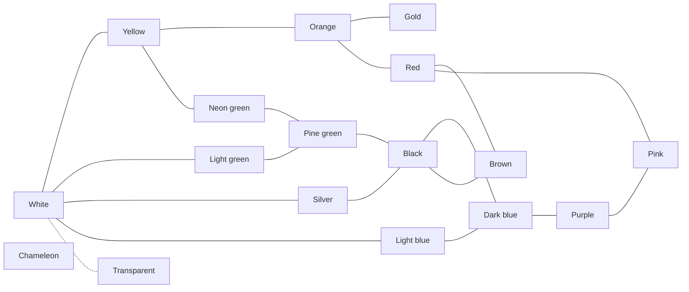

# Salamanders — Game Design Document

Version of 2026-10-29 · Guillaume Martigny

## Vision

A collection game where you raise small virtual salamanders and crossbreed them to bring out rare mutations. The core of the fun is the randomness of mutations: every hatching can hold a surprise.

- **Platform**: responsive web interface, playable on mobile in portrait mode.
- **Genre**: light idle game. Progress continues without the player, with no artificial friction and no premium currency.
- **Mode**: single-player at first.
- **Visuals**: salamanders generated from their genes, even with simple rendering. Pencil.js is being considered but not required.

## Genetics

Each salamander carries four genes, each with its own way of evolving. Every value has a Latin name, which gives each individual a species name.

| Gene | Values | Visual role | Mechanism |
| --- | --- | --- | --- |
| Primary color | 17 | Background color | Mutation in the color graph |
| Secondary color | 17 | Pattern color | Mutation in the color graph |
| Pattern | 14 + no pattern (*iustus*) | Motif on the body | Pattern fusion between parents |
| Detail | 7 (including none) | Physical trait | Influenced by terrarium decorations |

### Color inheritance

1. The primary color is drawn first: inherited from one parent, then possibly mutated.
2. The secondary color is drawn from the parents' colors, with the resulting primary color removed from the pool.
3. If the pool is empty, the secondary color is forced to mutate to a neighbor in the graph.

- Primary and secondary colors must differ, including for an *iustus* individual whose secondary color is hidden.
- Only exception: chameleon / chameleon is allowed.
- An *iustus* individual still passes on its hidden secondary color. It can reappear in its offspring.

With two distinct colors, there are about 26,900 visible combinations (17 × 16 × 14 × 7, plus the no-pattern cases).

### Species names

Each salamander gets a Latin-sounding name of two or three words. It follows the spirit of scientific names without their strict rules: no genus, and each word has its own ending so the player can tell the genes apart.

| Word | Gene | Ending | Example |
| --- | --- | --- | --- |
| 1st | Primary color | -us | *Albus* (white) |
| 2nd | Secondary color + pattern, joined | -o + -ata | *rubropunctata* (red dots) |
| 3rd | Detail | -um | *cornum* (horned) |

- Example: *Albus rubropunctata cornum*, a white salamander with red dots and horns.
- No pattern: the hidden secondary color is left out (*Aureus nudata*).
- No detail: the third word is left out (*Ebenus flavostrigata*).

| Color | Word | Combining form |
| --- | --- | --- |
| White | albus | albo- |
| Silver | argenteus | argenteo- |
| Gold | aureus | aureo- |
| Yellow | flavus | flavo- |
| Orange | rutilus | rutilo- |
| Red | rubeus | rubro- |
| Brown | fuscus | fusco- |
| Pink | roseus | roseo- |
| Purple | purpureus | purpureo- |
| Light blue | azureus | azureo- |
| Dark blue | caeruleus | caeruleo- |
| Light green | viridus | virido- |
| Neon green | citreus | citreo- |
| Pine green | prasinus | prasino- |
| Black | ebenus | ebeno- |
| Transparent | vitreus | vitreo- |
| Chameleon | mutabilus | mutabilo- |

Patterns: vertical lines *lineata*, zebra *strigata*, leaf *foliata*, clouds *nebulata*, splash *maculata*, dots *punctata*, rings *annulata*, gradient *gradata*, legs only *gambata*, head only *capitata*, swirls *volutata*, arrows *sagittata*, star *stellata*, skull *craniata*, no pattern *nudata*.

Details keep their Latin name: *cornum*, *palmatum*, *lucidum*, *oculum*, *pumilum*, *frondosum*.

## Colors and mutations

At birth, each inherited color can mutate to a neighboring color in the graph. Links work both ways.

Solid line: mutation possible both ways. Dotted line: very rare transition. The chameleon is linked to every color (not drawn), with a very rare transition.

White is the starting color. Black is the hub between greens, blues and brown.

- **Rarity**: each color has its own rarity, independent of its distance from white. When a color mutates, the target is picked among its neighbors, weighted by their rarity. Transitions have no rarity of their own.
- **Transparent**: reachable only from white, with a very low probability.
- **Chameleon**: linked to every color, with a very low probability. Its color changes constantly.

Temporary rarity weights (higher is more common), to tune by playing:

| Weight | Colors |
| --- | --- |
| 100 (very common) | White |
| 50 (common) | Yellow, orange, brown, pink, light blue, dark blue, light green, neon green, pine green |
| 30 (bridge, slightly rarer) | Black, red |
| 10 (rare) | Silver, gold, purple |
| 1 (very rare) | Transparent, chameleon |

The spreadsheet's color names map to the graph as follows: cyan is light blue, blue is dark blue, lime green is neon green.

## Patterns and details

To avoid repeating the color mechanism, patterns and details each evolve in a different way.

### Patterns: fusion

- Crossing two parents with specific patterns can produce a new pattern (example: dots + rings → star).
- The player discovers these "recipes" by experimenting, which complements the randomness of colors.
- Patterns: vertical lines (*recta*), zebra (*riga*), leaf (*folia*), clouds (*nuba*), splash (*macula*), dots (*puncta*), rings (*annula*), gradient (*progressa*), legs only (*gamba*), head only (*capita*), swirls (*voluta*), arrows (*sagitta*), star (*stella*), skull (*crania*).
- No pattern (*iustus*): only the primary color is visible.

Recipes (source: "Mélange des pattern" tab of the "Espèces" spreadsheet). Parent order does not matter, and a pair of the same pattern produces a different one (mutation). A result never appears twice among the recipes that share a parent. Every pattern leads to another one, except the skull, the end of the chain. Dots and clouds are the bridges to the rarer patterns. Any pattern can also be bought at the market, so the chain does not need a single starting point.

| Parents | Result |
| --- | --- |
| Vertical lines + vertical lines | Zebra |
| Vertical lines + zebra | Arrows |
| Zebra + zebra | Rings |
| Rings + rings | Dots |
| Dots + dots | Clouds |
| Clouds + clouds | Splash |
| Vertical lines + clouds | Gradient |
| Dots + rings | Star |
| Clouds + arrows | Leaf |
| Leaf + leaf | Swirls |
| Rings + gradient | Legs only |
| Legs only + legs only | Head only |
| Dots + head only | Skull |
| Splash + splash | Dots |
| Swirls + swirls | Clouds |
| Star + star | Splash |

Temporary pattern rarity weights: vertical lines 100 (very common), dots and clouds 30 (bridges), skull 1 (very rare), all others 50.

### Details: environment

The theme of a terrarium's decorations increases the chance of one detail appearing. Each theme favors exactly one detail.

| Decoration theme | Favored detail |
| --- | --- |
| Desert | Horned (*cornum*) |
| Swamp | Webbed (*palmatum*) |
| Cave | Luminescent (*lucidum*) |
| Deep ocean | Big eyes (*oculum*) |
| City | Dwarf (*pumilum*) |
| Jungle | Leafy (*frondosum*) |

- The detail can appear from 2 decorations of the same theme. Its chance then grows linearly up to 10% with all 5 decorations of that theme (2.5% with 2, 5% with 3, 7.5% with 4).
- A terrarium with few decorations favors no pattern (*iustus*) instead of a detail.
- With no theme influence, a salamander has no detail.

To decide: what counts as "few decorations", and whether decoration quality also affects the detail chance.

## Life cycle and breeding

The terrarium is the breeding pen: the player chooses crosses by distributing males and females across terrariums.

1. **Laying**: adults in the same terrarium breed as long as there is room. The delay between two layings is random within a range set by happiness (see below).
2. **Egg**: it incubates directly in the terrarium and takes up a slot. Incubation lasts 30 seconds.
3. **Pupa**: intermediate stage before adulthood. It lasts 2 minutes.
4. **Adult**: final stage; the salamander never dies.

- Salamanders have a sex. If several pairs are possible in a terrarium, the male/female pair is drawn at random. Isolating a single pair forces a specific cross.
- A full terrarium produces no more eggs. To continue, the player sells salamanders or buys a terrarium.
- While offline, laying continues until the terrariums are full: a natural limit, with no artificial friction.

### Happiness

- Each salamander has a happiness level, from 0 (base) to 1 (maximum), which sets its breeding rate.
- A terrarium holds up to 5 decorations, one of each type. The quality of its decorations adds happiness. Maximum happiness = all 5 decorations of the same theme.
- Each decoration outside the terrarium's main theme lowers happiness a little (temporary value: −0.05).

| Happiness | Delay between two layings |
| --- | --- |
| 0 (base) | 3 to 5 minutes |
| 1 (maximum) | 1 to 2 minutes |

In between, both bounds of the range move linearly with happiness.

The very first laying of a new game is forced to happen after 10 seconds, so a new player sees a hatching within a minute.

To decide: the decoration quality scale and exactly how much happiness each quality level adds.

## Economy

A single currency, **coins** (working name), is used for all purchases and sales.

- **Start**: the player begins with enough to buy a small terrarium and a pair of common salamanders.
- **Specimen price**: based on its rarity. Rarity comes from the probability of the mutations that produced its traits, combined with the rarity of its detail.
- **Terrariums**: the player can own up to 10. Their size sets the number of individuals, and each new terrarium costs 1.5 times the previous one (source: "Echelle de prix" tab of the "Espèces" spreadsheet).

| Size | Capacity | 1st | 2nd | 3rd | … | 10th |
| --- | --- | --- | --- | --- | --- | --- |
| Small | 4 | 100 | 150 | 225 | … | 3,844 |
| Medium | 7 | 1,000 | 1,500 | 2,250 | … | 38,443 |
| Large | 10 | 10,000 | 15,000 | 22,500 | … | 384,434 |

- **Decorations**: each has a type, a theme and a quality. The quality adds happiness and sets the price. The theme influences details and personalizes the terrarium.
    - Types: plant, rock, light, toy, shelter.
    - Themes: desert, swamp, cave, deep ocean, city, jungle.
    - Each type exists in every theme (example shelters: cattle skull in the desert, hollow stump in the swamp, crevice in the cave, shell in the deep ocean, tin can in the city, coconut in the jungle).
- **Special orders**: one or more salamanders with specific traits to deliver within a time limit, for an attractive coin reward.

### Market

The market has two sections, and both offers rotate at a regular interval (example: every 10 minutes).

- **Specimens**: random salamanders, delivered after a short delay. They help diversify genes.
- **Terrariums**:
    - an additional terrarium;
    - a larger terrarium, at an increasing price;
    - decorations, with a rotating offer like the specimens.

The price rank counts all terrariums owned, whatever their size: a 3rd terrarium costs the 3rd price of its size.

To decide: whether buying a larger terrarium replaces an existing one, and the decoration quality scale and its prices.

## Goals and encyclopedia

The player always has a goal at each of three horizons, and the encyclopedia carries the feeling of completion.

| Horizon | Goal | Reward |
| --- | --- | --- |
| Short term | Special orders | Coins |
| Medium term | Complete a themed collection | Dedicated reward |
| Long term | Complete the encyclopedia, with an overall % rate | Prestige |

### Encyclopedia

- Every discovered combination is recorded.
- Pages by color, by pattern and by detail make progress readable despite the ~26,900 combinations.

### Themed collections

Each collection groups 5 to 10 specific salamanders, with fun references. Ideas:

- **Holidays**: Halloween (*crania* orange on black), Saint Patrick's Day (*folia* green on light green), Christmas…
- **Flags**: France, Italy, Jamaica…
- **Pop culture**: rasta (*nuba* red, green, yellow), the plumbers (red *gamba* and green *gamba*)…
- **Nature**: zebra (*riga* black on white), ladybug, bee…
- **Lights and colors**: traffic light, rainbow…

If the game goes public, avoid trademarked names ("the plumbers" rather than the characters' names).

## Technical and open points

- **Rendering**: salamanders drawn procedurally from their genes. There is an old static prototype: [gmartigny.github.io/salamander](https://gmartigny.github.io/salamander/).
- **Sources**: Brainstorm, "Espèces" spreadsheet and "Couleurs" drawing in the project's Drive folder.

### To decide

- [ ] Decoration quality scale: happiness per level and prices
- [ ] Whether buying a larger terrarium replaces an existing one
- [ ] "Few decorations" threshold for no pattern (*iustus*)
- [ ] Full list of themed collections
- [ ] Tune the temporary rarity weights by playing
