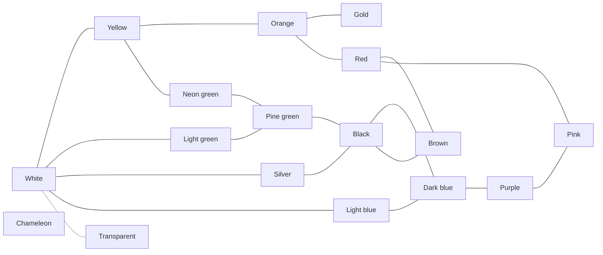

# Salamanders — Game Design Document

Version of 2026-10-29 · Guillaume Martigny

## Vision

A collection game where you raise small virtual salamanders and crossbreed them to bring out rare mutations. The core of the fun is the randomness of mutations: every hatching can hold a surprise.

- **Platform**: responsive web interface, playable on mobile in portrait mode.
- **Genre**: light idle game. Progress continues without the player, with no artificial friction and no premium currency.
- **Mode**: single-player at first.
- **Visuals**: salamanders generated from their genes, even with simple rendering. Pencil.js is being considered but not required.

## Genetics

Each salamander carries four genes, each with its own way of evolving. Every value has a Latin name, which gives each individual a species name.

| Gene | Values | Visual role | Mechanism |
| --- | --- | --- | --- |
| Primary color | 17 | Background color | Mutation in the color graph |
| Secondary color | 17 | Pattern color | Mutation in the color graph |
| Pattern | 14 + no pattern (*iustus*) | Motif on the body | Pattern fusion between parents |
| Detail | 7 (including none) | Physical trait | Influenced by terrarium decorations |

### Color inheritance

1. The primary color is drawn first: inherited from one parent, then possibly mutated.
2. The secondary color is drawn from the parents' colors, with the resulting primary color removed from the pool.
3. If the pool is empty, the secondary color is forced to mutate to a neighbor in the graph.

- Primary and secondary colors must differ, including for an *iustus* individual whose secondary color is hidden.
- Only exception: chameleon / chameleon is allowed.
- An *iustus* individual still passes on its hidden secondary color. It can reappear in its offspring.

With two distinct colors, there are about 26,900 visible combinations (17 × 16 × 14 × 7, plus the no-pattern cases).

## Colors and mutations

At birth, each inherited color can mutate to a neighboring color in the graph. Links work both ways.

Solid line: mutation possible both ways. Dotted line: very rare transition. The chameleon is linked to every color (not drawn), with a very rare transition.

White is the starting color. Black is the hub between greens, blues and brown.

- **Rarity**: each color has its own rarity, independent of its distance from white. The chance of mutating to a color depends on the rarity of that target color.
- **Silver and gold**: rare colors.
- **Transparent**: reachable only from white, with a very low probability.
- **Chameleon**: linked to every color, with a very low probability. Its color changes constantly.

To decide: the rarity value of each color.

## Patterns and details

To avoid repeating the color mechanism, patterns and details each evolve in a different way.

### Patterns: fusion

- Crossing two parents with specific patterns can produce a new pattern (example: dots + rings → star).
- The player discovers these "recipes" by experimenting, which complements the randomness of colors.
- Patterns: vertical lines (*recta*), zebra (*riga*), leaf (*folia*), clouds (*nuba*), splash (*macula*), dots (*puncta*), rings (*annula*), gradient (*progressa*), legs only (*gamba*), head only (*capita*), swirls (*voluta*), arrows (*sagitta*), star (*stella*), skull (*crania*).
- No pattern (*iustus*): only the primary color is visible.

### Details: environment

- The theme of a terrarium's decorations increases the chance of certain details appearing (examples: swamp → webbed, jungle → leafy).
- Details: none, horned (*cornum*), webbed (*palmatum*), luminescent (*lucidum*), big eyes (*oculum*), dwarf (*pumilum*), leafy (*frondosum*).

To decide: the fusion recipe table and the theme → detail table.

## Life cycle and breeding

The terrarium is the breeding pen: the player chooses crosses by distributing males and females across terrariums.

1. **Laying**: adults in the same terrarium have a chance to breed, as long as there is room. The delay between two layings is random within a range (example: 1 to 5 minutes). The happiness of the pair sets this breeding rate.
2. **Egg**: it incubates directly in the terrarium and takes up a slot.
3. **Pupa**: intermediate stage before adulthood.
4. **Adult**: final stage; the salamander never dies.

- Salamanders have a sex. If several pairs are possible in a terrarium, the male/female pair is drawn at random. Isolating a single pair forces a specific cross.
- A full terrarium produces no more eggs. To continue, the player sells salamanders or buys a terrarium.
- While offline, laying continues until the terrariums are full: a natural limit, with no artificial friction.

### Happiness

- Each salamander has a happiness level, which sets its breeding rate.
- The quality of the decorations in its terrarium adds happiness.

To decide: the happiness scale and how it converts into a breeding rate. Incubation and pupa durations. Constraint: the first hatching must happen very quickly (lead: first laying in under a minute, egg 1 to 2 minutes, pupa about 5 minutes).

## Economy

A single currency, **coins** (working name), is used for all purchases and sales.

- **Start**: the player begins with enough to buy a small terrarium and a pair of common salamanders.
- **Specimen price**: based on its rarity. Rarity comes from the probability of the mutations that produced its traits, combined with the rarity of its detail.
- **Terrariums**: the player can buy as many as they want. Their size sets the number of individuals.
- **Decorations**: each has a theme (desert, swamp, jungle…) and a quality. The quality adds happiness and sets the price. The theme influences details and personalizes the terrarium.
- **Special orders**: one or more salamanders with specific traits to deliver within a time limit, for an attractive coin reward.

### Market

The market has two sections, and both offers rotate at a regular interval (example: every 10 minutes).

- **Specimens**: random salamanders, delivered after a short delay. They help diversify genes.
- **Terrariums**:
    - an additional terrarium;
    - a larger terrarium, at an increasing price;
    - decorations, with a rotating offer like the specimens.

To decide: the numeric rarity of each color, pattern and detail, the terrarium price curve, the decoration quality scale and its prices, and the list of themes.

## Goals and encyclopedia

The player always has a goal at each of three horizons, and the encyclopedia carries the feeling of completion.

| Horizon | Goal | Reward |
| --- | --- | --- |
| Short term | Special orders | Coins |
| Medium term | Complete a themed collection | Dedicated reward |
| Long term | Complete the encyclopedia, with an overall % rate | Prestige |

### Encyclopedia

- Every discovered combination is recorded.
- Pages by color, by pattern and by detail make progress readable despite the ~26,900 combinations.

### Themed collections

Each collection groups 5 to 10 specific salamanders, with fun references. Ideas:

- **Holidays**: Halloween (*crania* orange on black), Saint Patrick's Day (*folia* green on light green), Christmas…
- **Flags**: France, Italy, Jamaica…
- **Pop culture**: rasta (*nuba* red, green, yellow), the plumbers (red *gamba* and green *gamba*)…
- **Nature**: zebra (*riga* black on white), ladybug, bee…
- **Lights and colors**: traffic light, rainbow…

If the game goes public, avoid trademarked names ("the plumbers" rather than the characters' names).

## Technical and open points

- **Rendering**: salamanders drawn procedurally from their genes. There is an old static prototype: [gmartigny.github.io/salamander](https://gmartigny.github.io/salamander/).
- **Sources**: Brainstorm, "Espèces" spreadsheet and "Couleurs" drawing in the project's Drive folder.

### To decide

- [ ] Numeric rarity of each color, each graph transition, each pattern and each detail
- [ ] Pattern fusion recipes
- [ ] Theme → detail table, and the list of decoration themes
- [ ] Durations: laying delay, incubation, pupa
- [ ] Prices: terrarium price curve, decoration quality scale and prices
- [ ] Happiness scale and its conversion into a breeding rate
- [ ] Full list of themed collections
- [ ] Unify the color lists between the Brainstorm and the spreadsheet (neon green, light blue, cyan, lime green…)
- [ ] Harmonize Latin names (endings, typos)
